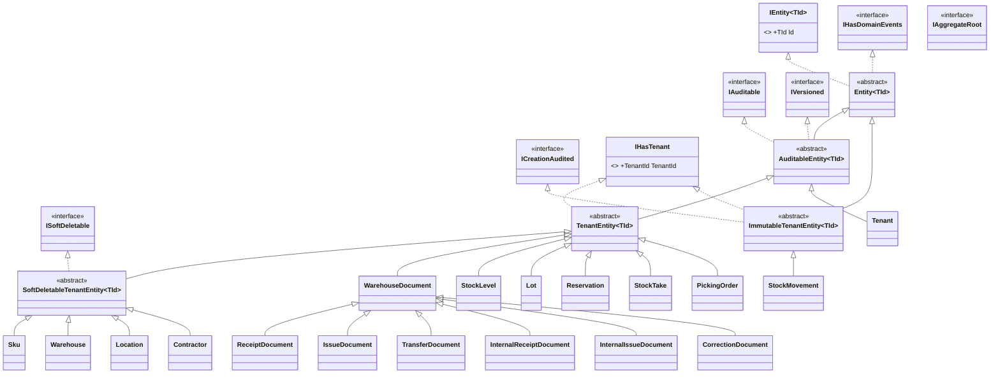
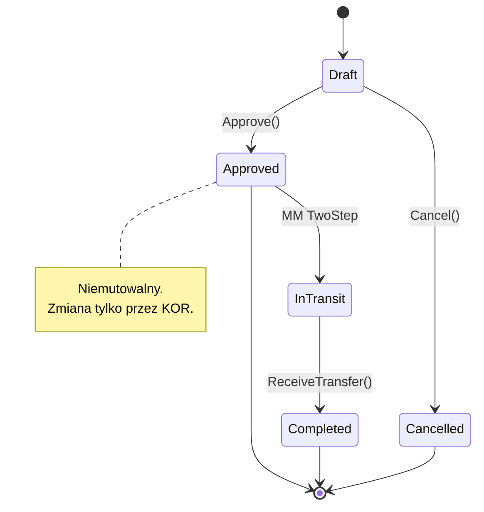
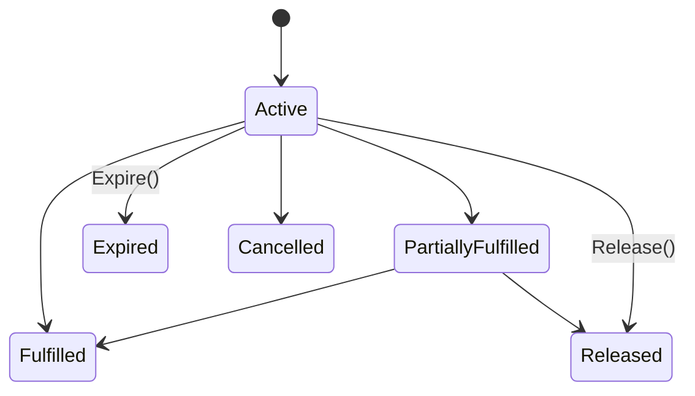
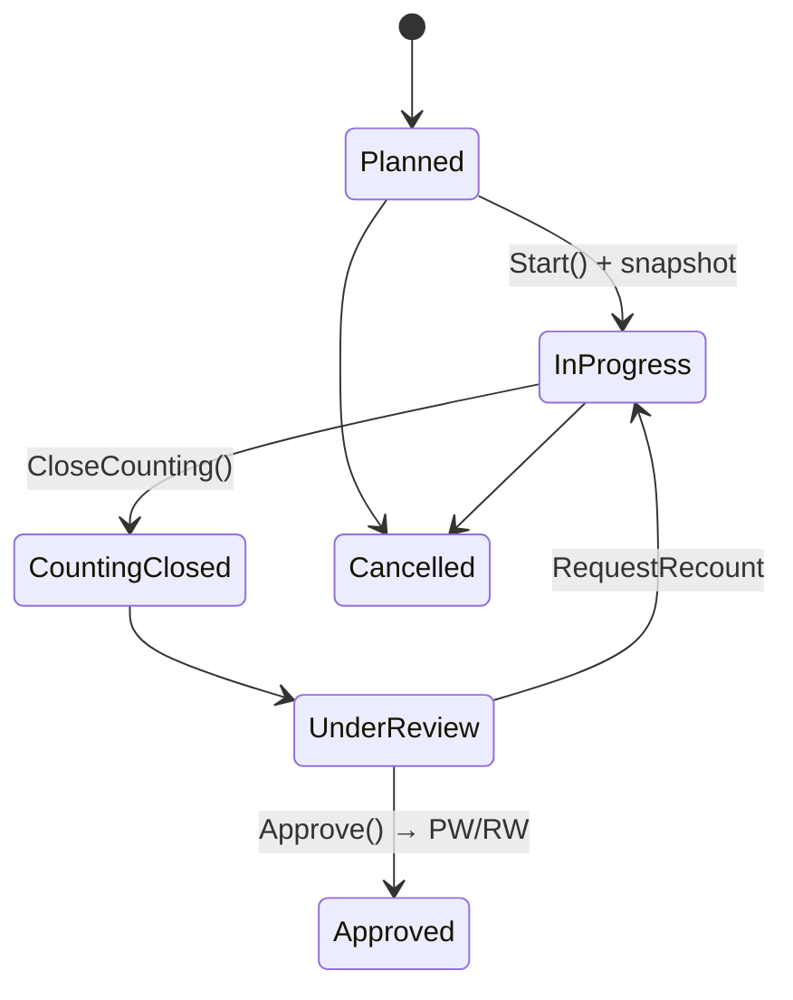
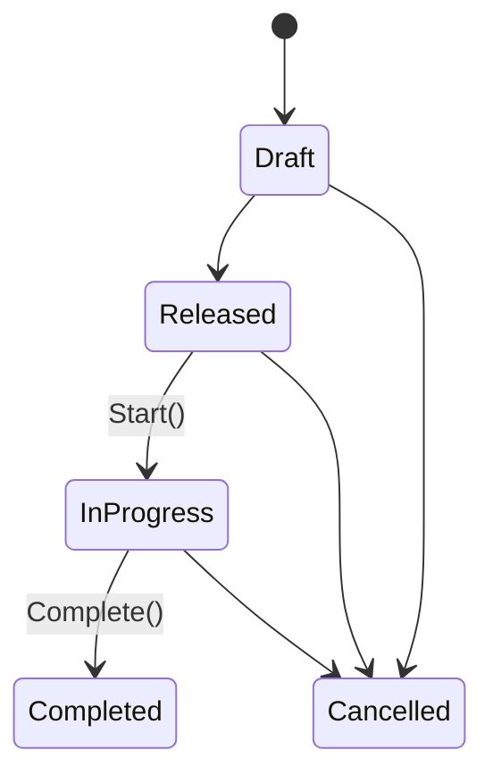

# Warehouse — specyfikacja modelu domenowego

> Dokument dla architekta / implementatora. Opisuje **wszystkie klasy domenowe, ich właściwości, interfejsy, klasy abstrakcyjne i hierarchię dziedziczenia**.
> Nie zawiera implementacji — tylko kontrakt. Uzupełnia `ZALOZENIA.md`.
> Stack: .NET 10 / C# 14 · Vertical Slice w jednym projekcie Web API · DDD · PostgreSQL · **multi-tenant (shared DB, `TenantId`)**.

---

## 0. Konwencje (obowiązujące w całym dokumencie)

| Temat | Zasada |
|-------|--------|
| Nazewnictwo | Identyfikatory w kodzie po angielsku; polskie odpowiedniki w słowniku `docs/domain/glossary.md` |
| Identyfikatory | **Strongly-typed ID**: `readonly record struct XxxId(Guid Value) : IStronglyTypedId<Guid>`; generowane `Guid.CreateVersion7()` |
| Czas | `DateTimeOffset` (UTC) dla momentów, `DateOnly` dla dat kalendarzowych (data dokumentu, data ważności). Nigdy `DateTime.Now` — tylko `IClock` / `TimeProvider` |
| Ilości | `decimal`, skala 4 (`numeric(18,4)`); zawsze w `Quantity` (wartość + jednostka) |
| Pieniądze | `Money` (`decimal` skala 4 + `CurrencyCode`) |
| Nullability | `#nullable enable`; `?` = opcjonalne biznesowo |
| Konstruktory | Encje: `private` bezparametrowy (EF) + publiczna **fabryka statyczna** `Create(...)` zwracająca `Result<T>` lub rzucająca `DomainException`. Brak publicznych setterów |
| Kolekcje | Pole `private readonly List<T>`, publicznie `IReadOnlyCollection<T>` |
| Zdarzenia | Agregat woła `Raise(IDomainEvent)`; dispatch po `SaveChanges` (patrz §9) |
| Błędy | Naruszenie niezmiennika → `DomainException(Error)`; w warstwie slice mapowane na `ProblemDetails` |
| Multi-tenancy | **Każda** encja poza `Tenant` dziedziczy po `TenantEntity<TId>` (lub `ImmutableTenantEntity<TId>`), ma `TenantId`, globalny query filter w EF, `TenantId` jest pierwszą kolumną każdego indeksu |
| Strefy czasowe | Przechowujemy UTC; `Tenant.TimeZone` / `Warehouse.TimeZone` używane tylko do prezentacji i granic dnia |

---

## 1. Hierarchia dziedziczenia — przegląd

### 1.1 Drzewo klas bazowych (SharedKernel)

```text
Entity<TId>                                  : IEntity<TId>, IHasDomainEvents
│
├── AuditableEntity<TId>                     : IAuditable, IVersioned
│   │
│   ├── Tenant                               : IAggregateRoot   (jedyna encja BEZ TenantId — korzeń tenantów)
│   │
│   └── TenantEntity<TId>   (abstract)       : IHasTenant
│       │
│       ├── SoftDeletableTenantEntity<TId>   : ISoftDeletable   (dane podstawowe)
│       │   ├── Sku                          : IAggregateRoot
│       │   ├── SkuCategory                  : IAggregateRoot
│       │   ├── Contractor                   : IAggregateRoot
│       │   ├── Warehouse                    : IAggregateRoot
│       │   ├── Location                     : IAggregateRoot
│       │   └── UnitOfMeasure
│       │
│       ├── WarehouseDocument   (abstract)   : IAggregateRoot
│       │   ├── ReceiptDocument              (PZ)
│       │   ├── IssueDocument                (WZ)
│       │   ├── TransferDocument             (MM)
│       │   ├── InternalReceiptDocument      (PW)
│       │   ├── InternalIssueDocument        (RW)
│       │   └── CorrectionDocument           (KOR)
│       │
│       ├── DocumentLine        (abstract)   (encja zależna od dokumentu)
│       │   ├── ReceiptLine
│       │   ├── IssueLine
│       │   ├── TransferLine
│       │   ├── InternalReceiptLine
│       │   ├── InternalIssueLine
│       │   └── CorrectionLine
│       │
│       ├── StockLevel                       : IAggregateRoot
│       ├── Lot                              : IAggregateRoot
│       ├── SerialItem                       : IAggregateRoot
│       ├── Reservation                      : IAggregateRoot
│       │   ├── ReservationLine              (zależna)
│       │   └── ReservationAllocation        (zależna)
│       ├── CostLayer
│       ├── SkuCostBalance
│       ├── PickingOrder                     : IAggregateRoot
│       │   └── PickingLine                  (zależna)
│       ├── PutawayTask                      : IAggregateRoot
│       ├── StockTake                        : IAggregateRoot
│       │   └── StockTakeLine                (zależna)
│       ├── AlertRule                        : IAggregateRoot
│       ├── Alert
│       ├── DocumentNumberSequence
│       └── (encje zależne katalogu: SkuBarcode, SkuUnitConversion, ContractorAddress, ContractorContact)
│
└── ImmutableTenantEntity<TId> (abstract)    : IHasTenant, ICreationAudited   (append-only)
    └── StockMovement                        (dziennik ruchów — źródło prawdy)

ValueObject (abstract)                       : IEquatable<ValueObject>
Enumeration (abstract)                       : IComparable   (smart enums)
```

### 1.2 Diagram (Mermaid)



### 1.3 Zasada doboru klasy bazowej

| Potrzeba | Klasa bazowa |
|----------|--------------|
| Dane podstawowe, które się dezaktywuje/„usuwa" logicznie | `SoftDeletableTenantEntity<TId>` |
| Dokumenty, rezerwacje, stany, zlecenia (mutowalne, audytowane, bez soft-delete — mają własny status) | `TenantEntity<TId>` |
| Wpisy append-only (ledger) | `ImmutableTenantEntity<TId>` |
| Korzeń tenantów | `AuditableEntity<TId>` |

> **Encje zależne** (linie dokumentu itp.) też dziedziczą po `TenantEntity<TId>` — `TenantId` jest zdenormalizowany, bo query filter i indeksy muszą działać bez joina do nagłówka. Ustawiany z agregatu-rodzica w fabryce.

---

## 2. Interfejsy i klasy abstrakcyjne SharedKernel

### 2.1 Interfejsy znacznikowe i kontrakty

```csharp
public interface IStronglyTypedId<TValue> where TValue : notnull
{
    TValue Value { get; }
}

public interface IEntity<out TId> where TId : notnull
{
    TId Id { get; }
}

public interface IAggregateRoot { }                       // marker: korzeń agregatu (jedyny punkt wejścia do zapisu)

public interface IDomainEvent
{
    Guid EventId { get; }
    DateTimeOffset OccurredAt { get; }
    TenantId TenantId { get; }
}

public interface IHasDomainEvents
{
    IReadOnlyCollection<IDomainEvent> DomainEvents { get; }
    void ClearDomainEvents();
}

public interface IHasTenant
{
    TenantId TenantId { get; }
}

public interface ICreationAudited
{
    DateTimeOffset CreatedAt { get; }
    UserId? CreatedBy { get; }
}

public interface IAuditable : ICreationAudited
{
    DateTimeOffset? ModifiedAt { get; }
    UserId? ModifiedBy { get; }
}

public interface ISoftDeletable
{
    bool IsDeleted { get; }
    DateTimeOffset? DeletedAt { get; }
    UserId? DeletedBy { get; }
}

public interface IVersioned
{
    uint Version { get; }          // mapowane na xmin (PostgreSQL) — optymistyczna współbieżność
}
```

### 2.2 Klasy abstrakcyjne

| Klasa | Dziedziczy po / implementuje | Właściwości i zachowanie |
|-------|------------------------------|--------------------------|
| `Entity<TId>` | `IEntity<TId>`, `IHasDomainEvents` | `TId Id { get; protected init; }`; `IReadOnlyCollection<IDomainEvent> DomainEvents`; `protected void Raise(IDomainEvent)`; `void ClearDomainEvents()`; `Equals/GetHashCode` po `Id` i typie (z uwzględnieniem proxy EF); `==`/`!=` |
| `AuditableEntity<TId>` | `Entity<TId>`, `IAuditable`, `IVersioned` | `CreatedAt`, `CreatedBy`, `ModifiedAt`, `ModifiedBy`, `Version`. Wartości ustawia **interceptor EF** (`AuditingInterceptor`) przy `SaveChanges`, używając `IClock` i `ICurrentUser` — encja ich nie ustawia sama |
| `TenantEntity<TId>` | `AuditableEntity<TId>`, `IHasTenant` | `TenantId TenantId { get; private set; }`. Ustawiane przez interceptor z `ITenantContext` przy `Added` (lub jawnie w fabryce agregatu-rodzica). **Niezmienne po utworzeniu**; próba zmiany → wyjątek |
| `SoftDeletableTenantEntity<TId>` | `TenantEntity<TId>`, `ISoftDeletable` | `IsDeleted`, `DeletedAt`, `DeletedBy`; `void Delete()` / `void Restore()`; globalny query filter `!IsDeleted` |
| `ImmutableTenantEntity<TId>` | `Entity<TId>`, `IHasTenant`, `ICreationAudited` | Tylko `CreatedAt`, `CreatedBy`, `TenantId`; **brak** metod mutujących; interceptor blokuje `Modified`/`Deleted` (wyjątek) |
| `ValueObject` | `IEquatable<ValueObject>` | `protected abstract IEnumerable<object?> GetEqualityComponents()`; `Equals`, `GetHashCode`, `==`, `!=`. Preferowane `sealed record` tam, gdzie wystarcza równość strukturalna |
| `Enumeration` | `IComparable<Enumeration>` | `int Id`, `string Name`; `GetAll<T>()`, `FromId<T>(int)`, `FromName<T>(string)`; używana dla enumów z zachowaniem (`DocumentType`, `MovementType`, `DocumentStatus`) |
| `DomainEvent` (record, abstract) | `IDomainEvent` | `EventId = Guid.CreateVersion7()`, `OccurredAt`, `TenantId` — wypełniane w konstruktorze bazowym przez `IClock` przekazany z agregatu |
| `DomainException` | `Exception` | `Error Error`; tworzony z `Error` |

### 2.3 Wynik i błąd

```csharp
public sealed record Error(string Code, string Message, ErrorType Type);   // Code np. "Inventory.InsufficientStock"
public enum ErrorType { Validation, NotFound, Conflict, Forbidden, Unexpected }

public readonly struct Result            { bool IsSuccess; Error Error; }
public readonly struct Result<T>         { bool IsSuccess; T Value; Error Error; }
```

---

## 3. Identyfikatory (strongly-typed IDs)

Wszystkie: `readonly record struct <Nazwa>(Guid Value) : IStronglyTypedId<Guid>` z `static New()` (`Guid.CreateVersion7()`), `Empty`, `ToString()`, konwerter EF (`ValueConverter`) i konwerter System.Text.Json.

`TenantId`, `UserId`, `SkuId`, `SkuCategoryId`, `ContractorId`, `UnitOfMeasureId`, `WarehouseId`, `LocationId`, `DocumentId`, `DocumentLineId`, `StockMovementId`, `StockLevelId`, `LotId`, `SerialItemId`, `ReservationId`, `ReservationLineId`, `ReservationAllocationId`, `CostLayerId`, `SkuCostBalanceId`, `PickingOrderId`, `PickingLineId`, `PutawayTaskId`, `StockTakeId`, `StockTakeLineId`, `AlertRuleId`, `AlertId`, `DocumentNumberSequenceId`, `SkuBarcodeId`, `SkuUnitConversionId`.

> `StockMovementId` — dodatkowo kolumna `Sequence` (`long`, rosnąca per tenant) do porządkowania ledgera.

---

## 4. Value Objects

Wszystkie `sealed`, niemutowalne, z walidacją w fabryce `Create(...)`. Mapowane jako *owned types* / konwertery.

| Value Object | Właściwości | Reguły / operacje |
|--------------|-------------|-------------------|
| `Quantity` | `decimal Amount`, `UnitCode Unit` | `Amount` może być ujemne tylko w kontekście `QuantityDelta`; operacje `Add`, `Subtract`, `Negate`, `Multiply(decimal)`, `IsZero`, `IsPositive`; działania na różnych jednostkach → `DomainException`; zaokrąglenie wg `UnitOfMeasure.DecimalPlaces` |
| `UnitCode` | `string Value` (1–10 znaków, UPPER) | np. `PCS`, `KG`, `CTN`, `PAL`, `L` |
| `Money` | `decimal Amount`, `CurrencyCode Currency` | `Add/Subtract` tylko w tej samej walucie; `Multiply(decimal)`; `Zero(currency)` |
| `CurrencyCode` | `string Value` (ISO 4217, 3 litery) | walidacja po liście |
| `SkuCode` | `string Value` (≤ 50, bez spacji na brzegach, UPPER-trim) | unikalny w obrębie tenanta |
| `Barcode` | `string Value`, `BarcodeType Type` | walidacja sumy kontrolnej dla `Ean13`, `Ean8`, `UpcA`; `Code128`, `Gs1128`, `Custom` bez sumy |
| `LotNumber` | `string Value` (≤ 50) | unikalny w obrębie `(TenantId, SkuId)` |
| `SerialNumber` | `string Value` (≤ 100) | unikalny w obrębie `(TenantId, SkuId)` |
| `LocationCode` | `string Value` (≤ 40, wzorzec np. `A-01-03-2`) | unikalny w obrębie `(TenantId, WarehouseId)` |
| `WarehouseCode` | `string Value` (≤ 10) | unikalny w obrębie tenanta |
| `DocumentNumber` | `string Prefix`, `int Year`, `long Sequence`, `string Full` | `Full` np. `PZ/WH1/2026/000123`; tworzony wyłącznie przez `IDocumentNumberGenerator` |
| `ExternalReference` | `string Source`, `string Value` | np. `("ERP-ORDER","ZK/12/2026")`; do korelacji z zewnętrznymi systemami |
| `Address` | `Street`, `BuildingNo`, `ApartmentNo?`, `PostalCode`, `City`, `Region?`, `CountryCode` | |
| `ContactInfo` | `string? Email`, `string? Phone`, `string? PersonName` | walidacja formatu e-mail |
| `TaxId` | `string CountryCode`, `string Number` | walidacja NIP dla `PL` |
| `Dimensions` | `decimal Length`, `Width`, `Height`, `LengthUnit Unit` | `Volume` (computed) |
| `Weight` | `decimal Value`, `WeightUnit Unit` | konwersja do kg |
| `ShelfLife` | `int TotalDays`, `int MinRemainingDaysOnReceipt` | używany przy przyjęciu partii z datą ważności |
| `LocationCapacity` | `decimal? MaxWeightKg`, `decimal? MaxVolumeM3`, `decimal? MaxUnits`, `int? MaxPallets` | sprawdzane przez `ILocationCapacityPolicy` |
| `DateRange` | `DateOnly From`, `DateOnly To` | `From <= To` |
| `TenantCode` | `string Value` (slug, `[a-z0-9-]{3,40}`) | unikalny globalnie |
| `TenantSettings` | `bool AllowNegativeStock`, `AllocationStrategyType DefaultAllocationStrategy`, `ValuationMethod DefaultValuationMethod`, `TimeSpan? DefaultReservationTtl`, `CurrencyCode DefaultCurrency`, `bool RequireLocationOnReceipt`, `DocumentNumberingPolicy Numbering` | VO osadzony w `Tenant` |
| `DocumentNumberingPolicy` | `bool PerWarehouse`, `bool ResetYearly`, `int SequencePadding`, `string? PrefixOverride` | |

---

## 5. Enumeracje

### 5.1 Smart enums (`Enumeration`) — z zachowaniem

**`DocumentType`**

| Id | Name | Skrót | Klasa dokumentu | Efekt na stan |
|----|------|-------|-----------------|---------------|
| 1 | `Receipt` | PZ | `ReceiptDocument` | + |
| 2 | `Issue` | WZ | `IssueDocument` | − |
| 3 | `Transfer` | MM | `TransferDocument` | − / + |
| 4 | `InternalReceipt` | PW | `InternalReceiptDocument` | + |
| 5 | `InternalIssue` | RW | `InternalIssueDocument` | − |
| 6 | `Correction` | KOR | `CorrectionDocument` | ± |

Właściwości: `string Code`, `bool RequiresApproval`, `bool AffectsStock`.

**`MovementType`**

| Name | `Direction` | `AffectsValuation` | Źródło |
|------|-------------|--------------------|--------|
| `ReceiptExternal` | In | true | PZ |
| `IssueExternal` | Out | true | WZ |
| `TransferOut` | Out | false | MM |
| `TransferIn` | In | false | MM |
| `ReceiptInternal` | In | true | PW |
| `IssueInternal` | Out | true | RW |
| `StocktakeSurplus` | In | true | INW → PW |
| `StocktakeShortage` | Out | true | INW → RW |
| `CorrectionIncrease` | In | true | KOR |
| `CorrectionDecrease` | Out | true | KOR |
| `Reversal` | In/Out | true | storno ruchu |

Właściwości: `MovementDirection Direction`, `bool AffectsValuation`, `Sign` (+1/−1).

**`DocumentStatus`** — z metodą `bool CanTransitionTo(DocumentStatus next)`:

`Draft` → `Approved` → (`Completed` tylko MM dwuetapowe) ; `Draft` → `Cancelled`. Zatwierdzony nie jest edytowalny ani anulowalny — tylko korygowany `KOR`.

### 5.2 Zwykłe enumy C#

| Enum | Wartości |
|------|----------|
| `MovementDirection` | `In`, `Out` |
| `TrackingMode` | `None`, `Lot`, `Serial`, `LotAndSerial` |
| `AllocationStrategyType` | `Fifo`, `Fefo`, `Lifo`, `SpecificLot` |
| `ValuationMethod` | `WeightedAverage`, `Fifo` |
| `StockStatus` | `Available`, `Quarantine`, `Blocked`, `Damaged` |
| `LotStatus` | `Available`, `Quarantine`, `Blocked`, `Expired` |
| `SerialStatus` | `InStock`, `Reserved`, `Issued`, `Returned`, `Scrapped` |
| `LocationType` | `Zone`, `Aisle`, `Rack`, `Shelf`, `Bin`, `Receiving`, `Shipping`, `Staging`, `Quarantine`, `Damaged`, `Transit`, `Virtual` |
| `WarehouseType` | `Standard`, `Transit`, `Virtual`, `Consignment` |
| `ReservationType` | `Soft`, `Hard` |
| `ReservationStatus` | `Active`, `PartiallyFulfilled`, `Fulfilled`, `Released`, `Expired`, `Cancelled` |
| `PickingStatus` | `Draft`, `Released`, `InProgress`, `Completed`, `Cancelled` |
| `PickingLineStatus` | `Pending`, `Picked`, `Short`, `Cancelled` |
| `PutawayStatus` | `Pending`, `Assigned`, `Completed`, `Cancelled` |
| `StockTakeType` | `Full`, `Cycle`, `Partial` |
| `StockTakeStatus` | `Planned`, `InProgress`, `CountingClosed`, `UnderReview`, `Approved`, `Cancelled` |
| `StockTakeLineStatus` | `Pending`, `Counted`, `RecountRequested`, `Accepted` |
| `TransferMode` | `Immediate`, `TwoStep` |
| `InternalReceiptReason` | `Production`, `Surplus`, `StocktakeAdjustment`, `ReturnFromCustomer`, `Other` |
| `InternalIssueReason` | `Consumption`, `Damage`, `Expiry`, `Loss`, `OwnUse`, `StocktakeAdjustment`, `Other` |
| `CorrectionReason` | `QuantityError`, `CostError`, `WrongLot`, `WrongLocation`, `Other` |
| `TenantStatus` | `Active`, `Suspended`, `Deactivated` |
| `ContractorKind` (flags) | `Supplier = 1`, `Customer = 2` |
| `AlertType` | `LowStock`, `ExpiryApproaching`, `StocktakeVariance`, `NegativeStock` |
| `AlertStatus` | `Open`, `Acknowledged`, `Resolved` |
| `BarcodeType` | `Ean13`, `Ean8`, `UpcA`, `Code128`, `Gs1128`, `Custom` |
| `LengthUnit` / `WeightUnit` | `Mm, Cm, M` / `G, Kg` |
| `UnitKind` | `Count`, `Weight`, `Volume`, `Length`, `Other` |

---

## 6. Bounded contexts — klasy domenowe

Format: **klasa** · baza · rola → tabela właściwości → metody domenowe → niezmienniki.
`PK` = `Id`; wszystkie klasy poza `Tenant` mają `TenantId` (dziedziczone — pomijane w tabelach).

---

### 6.1 Kontekst: Tenancy

#### `Tenant` · `AuditableEntity<TenantId>`, `IAggregateRoot`

| Właściwość | Typ | Opis |
|------------|-----|------|
| `Code` | `TenantCode` | unikalny slug |
| `Name` | `string` | nazwa firmy |
| `Status` | `TenantStatus` | |
| `TimeZone` | `string` | IANA (np. `Europe/Warsaw`) |
| `Settings` | `TenantSettings` | VO osadzony |
| `TaxId` | `TaxId?` | |
| `Address` | `Address?` | |
| `ActivatedAt` / `SuspendedAt` | `DateTimeOffset?` | |

Metody: `Create`, `Rename`, `UpdateSettings`, `Suspend(reason)`, `Activate`, `Deactivate`.
Zdarzenia: `TenantCreated`, `TenantSuspended`, `TenantActivated`.
Niezmienniki: `Code` niezmienne po utworzeniu; zawieszony tenant odrzuca komendy mutujące (egzekwowane w pipeline, nie w agregatach innych kontekstów).

#### `DocumentNumberSequence` · `TenantEntity<DocumentNumberSequenceId>`

| Właściwość | Typ | Opis |
|------------|-----|------|
| `DocumentType` | `DocumentType` | |
| `WarehouseId` | `WarehouseId?` | `null` = numeracja globalna tenanta |
| `Year` | `int?` | `null` gdy brak resetu rocznego |
| `Prefix` | `string` | |
| `LastValue` | `long` | ostatnio wydany numer |

Metoda: `long Next()` — inkrementacja pod **blokadą wiersza** (`FOR UPDATE`) lub `xmin` + retry. Unikalny indeks `(TenantId, DocumentType, WarehouseId, Year)`.

---

### 6.2 Kontekst: Catalog

#### `UnitOfMeasure` · `SoftDeletableTenantEntity<UnitOfMeasureId>`

| Właściwość | Typ | Opis |
|------------|-----|------|
| `Code` | `UnitCode` | unikalny w tenancie |
| `Name` | `string` | |
| `Kind` | `UnitKind` | |
| `DecimalPlaces` | `int` | dopuszczalna precyzja (0 dla szt.) |

#### `SkuCategory` · `SoftDeletableTenantEntity<SkuCategoryId>`, `IAggregateRoot`

| Właściwość | Typ | Opis |
|------------|-----|------|
| `Code` | `string` | |
| `Name` | `string` | |
| `ParentId` | `SkuCategoryId?` | drzewo |
| `Path` | `string` | materialized path (np. `/1/4/9/`) |

#### `Sku` · `SoftDeletableTenantEntity<SkuId>`, `IAggregateRoot`

| Właściwość | Typ | Opis |
|------------|-----|------|
| `Code` | `SkuCode` | unikalny w tenancie |
| `Name` | `string` | |
| `Description` | `string?` | |
| `CategoryId` | `SkuCategoryId?` | |
| `BaseUnit` | `UnitCode` | jednostka bazowa — w niej liczy się cały stan i ledger |
| `TrackingMode` | `TrackingMode` | partie / numery seryjne |
| `RequiresExpiryDate` | `bool` | wymusza `ExpiryDate` na przyjęciu partii |
| `ShelfLife` | `ShelfLife?` | |
| `Dimensions` | `Dimensions?` | |
| `Weight` | `Weight?` | |
| `AllocationStrategy` | `AllocationStrategyType?` | `null` = domyślna z `TenantSettings` |
| `ValuationMethod` | `ValuationMethod?` | `null` = domyślna z `TenantSettings` |
| `ReorderPoint` | `decimal?` | próg alertu `LowStock` (w jedn. bazowej) |
| `MinStockLevel` | `decimal?` | |
| `DefaultSupplierId` | `ContractorId?` | |
| `VariantOfSkuId` | `SkuId?` | wariant produktu |
| `Attributes` | `IReadOnlyDictionary<string,string>` | JSONB — dowolne atrybuty/warianty |
| `IsActive` | `bool` | |
| `Barcodes` | `IReadOnlyCollection<SkuBarcode>` | |
| `UnitConversions` | `IReadOnlyCollection<SkuUnitConversion>` | |

Metody: `Create`, `Rename`, `ChangeTrackingMode` (zablokowane gdy istnieje stan), `AddBarcode`, `RemoveBarcode`, `SetPrimaryBarcode`, `AddUnitConversion`, `RemoveUnitConversion`, `ConvertToBase(Quantity)`, `ConvertFromBase(decimal, UnitCode)`, `Activate`, `Deactivate`, `Delete`.
Zdarzenia: `SkuCreated`, `SkuDeactivated`, `SkuTrackingModeChanged`.
Niezmienniki: `BaseUnit` niezmienna po pierwszym ruchu; tylko jeden `Barcode` z `IsPrimary`; przelicznik do jednostki bazowej `Factor > 0`; `RequiresExpiryDate` wymaga `TrackingMode ∈ {Lot, LotAndSerial}`.

#### `SkuBarcode` · `TenantEntity<SkuBarcodeId>` (zależna od `Sku`)

`SkuId`, `Barcode Barcode`, `UnitCode Unit` (opakowanie, którego dotyczy kod), `bool IsPrimary`.

#### `SkuUnitConversion` · `TenantEntity<SkuUnitConversionId>` (zależna od `Sku`)

`SkuId`, `UnitCode FromUnit`, `decimal Factor` (ile jedn. bazowych w 1 `FromUnit`; np. `CTN → 12`), `bool IsDefaultForReceipt`, `bool IsDefaultForIssue`.

#### `Contractor` · `SoftDeletableTenantEntity<ContractorId>`, `IAggregateRoot`

| Właściwość | Typ | Opis |
|------------|-----|------|
| `Code` | `string` | unikalny w tenancie |
| `Name` | `string` | |
| `Kind` | `ContractorKind` (flags) | dostawca / odbiorca / oba |
| `TaxId` | `TaxId?` | |
| `DefaultCurrency` | `CurrencyCode?` | |
| `PaymentTermsDays` | `int?` | |
| `IsActive` | `bool` | |
| `Addresses` | `IReadOnlyCollection<ContractorAddress>` | |
| `Contacts` | `IReadOnlyCollection<ContractorContact>` | |
| `ExternalReferences` | `IReadOnlyCollection<ExternalReference>` | |

`ContractorAddress` (zależna): `Address Address`, `AddressType Type (Billing, Shipping, Registered)`, `bool IsDefault`.
`ContractorContact` (zależna): `ContactInfo Contact`, `string? Role`.
Metody: `Create`, `Update`, `AddAddress`, `AddContact`, `Activate`, `Deactivate`, `Delete`.

---

### 6.3 Kontekst: Locations

#### `Warehouse` · `SoftDeletableTenantEntity<WarehouseId>`, `IAggregateRoot`

| Właściwość | Typ | Opis |
|------------|-----|------|
| `Code` | `WarehouseCode` | unikalny w tenancie |
| `Name` | `string` | |
| `Type` | `WarehouseType` | |
| `Address` | `Address?` | |
| `TimeZone` | `string?` | nadpisuje tenanta |
| `AllowNegativeStock` | `bool?` | `null` = z `TenantSettings` |
| `DefaultReceivingLocationId` | `LocationId?` | |
| `DefaultShippingLocationId` | `LocationId?` | |
| `DefaultQuarantineLocationId` | `LocationId?` | |
| `IsActive` | `bool` | |

Metody: `Create`, `Update`, `SetDefaultLocations`, `Activate`, `Deactivate` (zablokowane gdy niezerowy stan), `Delete`.
Zdarzenia: `WarehouseCreated`, `WarehouseDeactivated`.

#### `Location` · `SoftDeletableTenantEntity<LocationId>`, `IAggregateRoot`

Drzewo: `Warehouse → Zone → Aisle → Rack → Shelf → Bin` (jedna klasa, typ w `LocationType`).

| Właściwość | Typ | Opis |
|------------|-----|------|
| `WarehouseId` | `WarehouseId` | |
| `ParentId` | `LocationId?` | |
| `Code` | `LocationCode` | unikalny w `(TenantId, WarehouseId)` |
| `Name` | `string?` | |
| `Type` | `LocationType` | |
| `Path` | `string` | materialized path |
| `Level` | `int` | głębokość w drzewie |
| `IsPickable` | `bool` | wolno kompletować |
| `IsReceivable` | `bool` | wolno przyjmować |
| `IsStorable` | `bool` | wolno składować (lokalizacje „liściowe") |
| `AllowedStockStatuses` | `IReadOnlySet<StockStatus>` | np. `Quarantine` tylko w lokalizacji kwarantanny |
| `Capacity` | `LocationCapacity?` | |
| `Dimensions` | `Dimensions?` | |
| `PickSequence` | `int?` | kolejność w ścieżce kompletacji |
| `BlockedReason` | `string?` | `!= null` ⇒ lokalizacja zablokowana |
| `IsActive` | `bool` | |

Metody: `Create`, `Move(newParent)`, `Rename`, `Block(reason)`, `Unblock`, `Activate`, `Deactivate`, `Delete`.
Niezmienniki: brak cykli w drzewie; dziecko w tym samym `WarehouseId`; nie wolno zdezaktywować lokalizacji z niezerowym stanem; lokalizacja zablokowana nie przyjmuje ani nie wydaje.

---

### 6.4 Kontekst: Inventory (rdzeń)

#### `StockMovement` · `ImmutableTenantEntity<StockMovementId>` — **dziennik (ledger)**

Wyłącznie `INSERT`. Brak update/delete (interceptor + trigger DB).

| Właściwość | Typ | Opis |
|------------|-----|------|
| `Sequence` | `long` | monotoniczny numer w tenancie (`IDENTITY`/sekwencja) |
| `OccurredAt` | `DateTimeOffset` | moment zdarzenia biznesowego |
| `PostedAt` | `DateTimeOffset` | moment zaksięgowania (zwykle = `CreatedAt`) |
| `Type` | `MovementType` | |
| `WarehouseId` | `WarehouseId` | |
| `LocationId` | `LocationId` | |
| `SkuId` | `SkuId` | |
| `LotId` | `LotId?` | |
| `SerialItemId` | `SerialItemId?` | |
| `StockStatus` | `StockStatus` | status stanu, którego dotyczy ruch |
| `QuantityDelta` | `decimal` | **ze znakiem**, w jednostce bazowej Sku |
| `BaseUnit` | `UnitCode` | |
| `UnitCost` | `Money?` | koszt jednostkowy (jeśli `AffectsValuation`) |
| `TotalValue` | `Money?` | `QuantityDelta × UnitCost` |
| `DocumentId` | `DocumentId` | dokument-źródło |
| `DocumentLineId` | `DocumentLineId` | |
| `TransferPairId` | `Guid?` | wiąże `TransferOut` z `TransferIn` |
| `ReversesMovementId` | `StockMovementId?` | dla `Reversal` |
| `CorrelationId` | `Guid` | id żądania (do audytu i trace) |

Niezmienniki: `QuantityDelta != 0`; znak zgodny z `Type.Direction`; `Reversal` musi wskazywać `ReversesMovementId` i odwracać znak i wartość dokładnie.

#### `StockLevel` · `TenantEntity<StockLevelId>`, `IAggregateRoot` — **projekcja ledgera**

Jedna pozycja na kombinację `(Warehouse, Location, Sku, Lot?, StockStatus)`. Unikalny indeks `(TenantId, LocationId, SkuId, LotId, StockStatus)` (z `NULLS NOT DISTINCT`).

| Właściwość | Typ | Opis |
|------------|-----|------|
| `WarehouseId`, `LocationId`, `SkuId` | ID | |
| `LotId` | `LotId?` | |
| `StockStatus` | `StockStatus` | |
| `OnHand` | `decimal` | stan fizyczny |
| `Reserved` | `decimal` | zarezerwowane |
| `Available` | `decimal` | *computed* = `OnHand − Reserved` (kolumna generowana lub właściwość) |
| `InTransit` | `decimal` | do przyjęcia w MM dwuetapowym |
| `LastMovementSequence` | `long` | numer ostatniego zastosowanego ruchu (kontrola spójności/idempotentności) |
| `LastMovementAt` | `DateTimeOffset?` | |

Metody (wywoływane **wyłącznie** przez `IStockPostingService`): `Apply(StockMovement, bool allowNegative)`, `Reserve(decimal)`, `ReleaseReservation(decimal)`, `CommitReservation(decimal)`.
Niezmienniki: `OnHand >= 0` (chyba że `AllowNegativeStock`); `0 <= Reserved <= OnHand`; zastosowanie ruchu o `Sequence <= LastMovementSequence` jest odrzucane (idempotencja).
Zdarzenia: `StockChanged`, `NegativeStockDetected`.

#### `Lot` · `TenantEntity<LotId>`, `IAggregateRoot`

| Właściwość | Typ | Opis |
|------------|-----|------|
| `SkuId` | `SkuId` | |
| `LotNumber` | `LotNumber` | unikalny w `(TenantId, SkuId)` |
| `SupplierLotNumber` | `string?` | numer partii dostawcy |
| `SupplierId` | `ContractorId?` | |
| `ProductionDate` | `DateOnly?` | |
| `ExpiryDate` | `DateOnly?` | |
| `ReceivedAt` | `DateTimeOffset` | do FIFO |
| `Status` | `LotStatus` | |
| `Attributes` | `IReadOnlyDictionary<string,string>` | JSONB |

Metody: `Create`, `Block(reason)`, `Release`, `MoveToQuarantine`, `IsExpired(DateOnly today)`, `RemainingShelfLifeDays(DateOnly today)`.
Zdarzenia: `LotCreated`, `LotBlocked`, `LotExpired`.
Niezmienniki: `ExpiryDate >= ProductionDate`; partia wygasła/zablokowana nie jest alokowana do wydań.

#### `SerialItem` · `TenantEntity<SerialItemId>`, `IAggregateRoot`

| Właściwość | Typ | Opis |
|------------|-----|------|
| `SkuId` | `SkuId` | |
| `SerialNumber` | `SerialNumber` | unikalny w `(TenantId, SkuId)` |
| `LotId` | `LotId?` | |
| `Status` | `SerialStatus` | |
| `CurrentWarehouseId` / `CurrentLocationId` | ID? | `null` po wydaniu |
| `ReceivedDocumentLineId` | `DocumentLineId` | |
| `IssuedDocumentLineId` | `DocumentLineId?` | |
| `ReservationId` | `ReservationId?` | |

Metody: `Receive`, `MoveTo(locationId)`, `Reserve`, `Release`, `Issue`, `Return`, `Scrap`.
Niezmiennik: dozwolone przejścia statusów (np. `Issued` → tylko `Returned`); jeden numer seryjny nie może być równocześnie w dwóch lokalizacjach.

#### `Reservation` · `TenantEntity<ReservationId>`, `IAggregateRoot`

| Właściwość | Typ | Opis |
|------------|-----|------|
| `Number` | `string` | |
| `WarehouseId` | `WarehouseId` | |
| `Type` | `ReservationType` | miękka (informacyjna) / twarda (blokuje stan) |
| `Status` | `ReservationStatus` | |
| `ExternalReference` | `ExternalReference?` | zamówienie sprzedaży itp. |
| `CustomerId` | `ContractorId?` | |
| `Priority` | `int` | |
| `ExpiresAt` | `DateTimeOffset?` | |
| `Lines` | `IReadOnlyCollection<ReservationLine>` | |
| `ReleasedAt` / `ReleaseReason` | `DateTimeOffset?` / `string?` | |

`ReservationLine` (zależna): `SkuId`, `Quantity RequestedQuantity`, `decimal AllocatedQuantity`, `decimal FulfilledQuantity`, `LotId? RequiredLotId`, `LocationId? PreferredLocationId`, `Allocations`.
`ReservationAllocation` (zależna od linii): `StockLevelId`, `LotId?`, `LocationId`, `decimal Quantity`, `decimal FulfilledQuantity`.

Metody: `Create`, `AddLine`, `Allocate(IStockAllocationStrategy, availability)`, `Release(reason)`, `Expire(now)`, `Fulfill(lineId, qty)`, `Cancel`.
Zdarzenia: `StockReserved`, `ReservationReleased`, `ReservationExpired`, `ReservationFulfilled`.
Niezmienniki: `Σ Allocation.Quantity ≤ RequestedQuantity`; twarda rezerwacja zwiększa `StockLevel.Reserved` **w tej samej transakcji**; rezerwacja nie przekracza `Available`.

#### `CostLayer` · `TenantEntity<CostLayerId>` — warstwa kosztowa FIFO

`SkuId`, `WarehouseId`, `LotId?`, `ReceivedAt`, `decimal OriginalQuantity`, `decimal RemainingQuantity`, `Money UnitCost`, `StockMovementId SourceMovementId`. Metoda: `Consume(decimal qty) → (consumed, cost)`.

#### `SkuCostBalance` · `TenantEntity<SkuCostBalanceId>` — saldo kosztowe (średnia ważona)

`SkuId`, `WarehouseId`, `decimal QuantityOnHand`, `Money TotalValue`, `Money AverageUnitCost` (computed). Metody: `AddReceipt(qty, unitCost)`, `ConsumeAtAverage(qty) → Money`.

---

### 6.5 Kontekst: Documents

#### `WarehouseDocument` (abstract) · `TenantEntity<DocumentId>`, `IAggregateRoot`

Strategia mapowania EF: **TPH** (jedna tabela `documents.documents`, dyskryminator `DocumentType`).

| Właściwość | Typ | Opis |
|------------|-----|------|
| `Type` | `DocumentType` | **abstract**, dyskryminator |
| `Number` | `DocumentNumber?` | nadawany przy zatwierdzeniu |
| `Status` | `DocumentStatus` | |
| `WarehouseId` | `WarehouseId` | |
| `DocumentDate` | `DateOnly` | data księgowa |
| `Notes` | `string?` | |
| `ExternalReference` | `ExternalReference?` | |
| `ApprovedAt` / `ApprovedBy` | `DateTimeOffset?` / `UserId?` | |
| `CancelledAt` / `CancelledBy` / `CancellationReason` | `DateTimeOffset?` / `UserId?` / `string?` | |
| `Lines` | `IReadOnlyCollection<DocumentLine>` | |
| `CorrectedByDocumentIds` | `IReadOnlyCollection<DocumentId>` | |

Metody wspólne: `AddLine`, `UpdateLine`, `RemoveLine` (tylko `Draft`), `Approve(DocumentNumber, IClock)`, `Cancel(reason)`, `MarkCorrected(DocumentId)`;
metody abstrakcyjne/wirtualne: `protected abstract void ValidateForApproval()`, `public abstract IReadOnlyList<MovementDraft> BuildMovements()` — dokument opisuje, **jakie ruchy powstają**, a `IStockPostingService` je księguje.
Zdarzenia: `DocumentCreated`, `DocumentApproved`, `DocumentCancelled`.
Niezmienniki: edycja tylko w `Draft`; zatwierdzenie wymaga ≥ 1 linii i dodatnich ilości; po `Approved` dokument niemutowalny; `Approve` jest idempotentne względem `Idempotency-Key`.

#### `DocumentLine` (abstract) · `TenantEntity<DocumentLineId>`

| Właściwość | Typ | Opis |
|------------|-----|------|
| `DocumentId` | `DocumentId` | |
| `LineNumber` | `int` | |
| `SkuId` | `SkuId` | |
| `Quantity` | `Quantity` | w jednostce wpisanej przez użytkownika |
| `BaseQuantity` | `Quantity` | przeliczone na jednostkę bazową (zapisywane przy dodaniu linii) |
| `Notes` | `string?` | |

#### Dokumenty konkretne

**`ReceiptDocument` (PZ)**

| Właściwość | Typ |
|------------|-----|
| `SupplierId` | `ContractorId` |
| `SupplierDocumentNumber` | `string?` |
| `PurchaseOrderReference` | `ExternalReference?` |
| `ReceivedAt` | `DateTimeOffset?` |

`ReceiptLine : DocumentLine` — `ToLocationId LocationId`, `Money UnitCost`, `string? LotNumber`, `DateOnly? ProductionDate`, `DateOnly? ExpiryDate`, `IReadOnlyCollection<SerialNumber> SerialNumbers`, `StockStatus TargetStatus` (domyślnie `Available`).
Reguły: `TrackingMode=Lot` ⇒ wymagany `LotNumber`; `Serial` ⇒ `SerialNumbers.Count == BaseQuantity.Amount`; `RequiresExpiryDate` ⇒ wymagany `ExpiryDate` i spełnione `MinRemainingDaysOnReceipt`.
Ruchy: `ReceiptExternal` (+) na `ToLocationId`.

**`IssueDocument` (WZ)**

| Właściwość | Typ |
|------------|-----|
| `CustomerId` | `ContractorId` |
| `SalesOrderReference` | `ExternalReference?` |
| `ShippingAddress` | `Address?` |
| `ReservationId` | `ReservationId?` |
| `PickingOrderId` | `PickingOrderId?` |

`IssueLine : DocumentLine` — `FromLocationId LocationId?` (puste ⇒ alokacja automatyczna), `LotId? LotId`, `AllocationStrategyType? Strategy`, `IReadOnlyCollection<SerialItemId> SerialItemIds`, `Money? UnitPrice`, `ReservationLineId? ReservationLineId`.
Ruchy: `IssueExternal` (−); koszt z `IValuationStrategy`.

**`TransferDocument` (MM)**

| Właściwość | Typ |
|------------|-----|
| `SourceWarehouseId` | `WarehouseId` (= `WarehouseId` bazowe) |
| `TargetWarehouseId` | `WarehouseId` |
| `Mode` | `TransferMode` |
| `ShippedAt` / `ReceivedAt` | `DateTimeOffset?` |

`TransferLine : DocumentLine` — `FromLocationId`, `ToLocationId LocationId?` (dla `TwoStep` ustalane przy przyjęciu), `LotId?`, `SerialItemIds`, `decimal ReceivedQuantity`.
Ruchy: `Immediate` → `TransferOut` + `TransferIn` (wspólny `TransferPairId`) w jednej transakcji; `TwoStep` → `TransferOut` + `InTransit++`, potem `ReceiveTransfer` → `TransferIn`. Dodatkowy status `InTransit` w `DocumentStatus` dla `TwoStep`.

**`InternalReceiptDocument` (PW)** — `InternalReceiptReason Reason`, `string? CostCenter`; `InternalReceiptLine : DocumentLine` — jak `ReceiptLine` bez dostawcy (`ToLocationId`, `UnitCost`, `LotNumber?`, `ExpiryDate?`, `SerialNumbers`).

**`InternalIssueDocument` (RW)** — `InternalIssueReason Reason`, `string? CostCenter`; `InternalIssueLine : DocumentLine` — `FromLocationId?`, `LotId?`, `SerialItemIds`, `Strategy?`.

**`CorrectionDocument` (KOR)**

| Właściwość | Typ |
|------------|-----|
| `CorrectedDocumentId` | `DocumentId` |
| `Reason` | `CorrectionReason` |
| `ReasonDescription` | `string?` |

`CorrectionLine : DocumentLine` — `DocumentLineId OriginalLineId`, `decimal QuantityDelta` (±), `Money? NewUnitCost`, `LotId? NewLotId`, `LocationId? NewLocationId`.
Ruchy: `CorrectionIncrease` / `CorrectionDecrease` (lub `Reversal` + nowy ruch). Nigdy nie modyfikuje oryginału.

> **Inwentaryzacja** nie ma własnej klasy dokumentu: zatwierdzenie `StockTake` generuje `InternalReceiptDocument` / `InternalIssueDocument` z `Reason = StocktakeAdjustment`.

---

### 6.6 Kontekst: Fulfillment

#### `PickingOrder` · `TenantEntity<PickingOrderId>`, `IAggregateRoot`

| Właściwość | Typ | Opis |
|------------|-----|------|
| `Number` | `string` | |
| `WarehouseId` | `WarehouseId` | |
| `Status` | `PickingStatus` | |
| `Priority` | `int` | |
| `ReservationId` | `ReservationId?` | |
| `IssueDocumentId` | `DocumentId?` | powstaje po zakończeniu kompletacji |
| `AssignedTo` | `UserId?` | |
| `ReleasedAt`, `StartedAt`, `CompletedAt` | `DateTimeOffset?` | |
| `Lines` | `IReadOnlyCollection<PickingLine>` | |

`PickingLine` (zależna): `SkuId`, `LotId?`, `LocationId FromLocationId`, `LocationId? StagingLocationId`, `decimal QuantityRequired`, `decimal QuantityPicked`, `PickingLineStatus Status`, `ReservationAllocationId?`, `int Sequence` (kolejność ścieżki wg `Location.PickSequence`), `IReadOnlyCollection<SerialItemId> SerialItemIds`.
Metody: `Create`, `Release`, `Assign(userId)`, `Start`, `ConfirmPick(lineId, qty, serials?)`, `ReportShort(lineId, qty, reason)`, `Complete`, `Cancel`.
Zdarzenia: `PickingReleased`, `PickingCompleted`, `PickShortageReported`.

#### `PutawayTask` · `TenantEntity<PutawayTaskId>`, `IAggregateRoot`

`WarehouseId`, `SkuId`, `LotId?`, `decimal Quantity`, `LocationId SourceLocationId` (strefa przyjęć), `LocationId? SuggestedLocationId` (z `IPutawayStrategy`), `LocationId? ActualLocationId`, `PutawayStatus Status`, `DocumentLineId SourceDocumentLineId`, `UserId? AssignedTo`, `DateTimeOffset? CompletedAt`.
Metody: `Create`, `Suggest(strategy)`, `Assign`, `Complete(actualLocationId)` (generuje `TransferIn/Out` wewnątrz magazynu), `Cancel`.

---

### 6.7 Kontekst: Stocktaking

#### `StockTake` · `TenantEntity<StockTakeId>`, `IAggregateRoot`

| Właściwość | Typ | Opis |
|------------|-----|------|
| `Number` | `string` | |
| `WarehouseId` | `WarehouseId` | |
| `Type` | `StockTakeType` | |
| `Status` | `StockTakeStatus` | |
| `ScopeLocationIds` | `IReadOnlyCollection<LocationId>` | pusty = cały magazyn |
| `ScopeSkuIds` | `IReadOnlyCollection<SkuId>` | pusty = wszystkie |
| `FreezeStock` | `bool` | blokuje ruchy w zakresie na czas liczenia |
| `PlannedFor` | `DateOnly?` | |
| `StartedAt`, `CountingClosedAt`, `ApprovedAt` | `DateTimeOffset?` | |
| `ApprovedBy` | `UserId?` | |
| `AdjustmentDocumentIds` | `IReadOnlyCollection<DocumentId>` | wygenerowane PW/RW |
| `Lines` | `IReadOnlyCollection<StockTakeLine>` | |

`StockTakeLine` (zależna): `LocationId`, `SkuId`, `LotId?`, `decimal SystemQuantity` (snapshot na `StartedAt`), `decimal? CountedQuantity`, `decimal? Difference` (computed), `UserId? CountedBy`, `DateTimeOffset? CountedAt`, `StockTakeLineStatus Status`, `string? Comment`, `int RecountNumber`.
Metody: `Plan`, `Start` (robi snapshot `StockLevel`), `RecordCount(lineId, qty, userId)`, `RequestRecount(lineId)`, `CloseCounting`, `Approve` (generuje korekty), `Cancel`.
Zdarzenia: `StockTakeStarted`, `StockTakeClosed`, `StockTakeApproved`, `StockTakeVarianceDetected`.
Niezmienniki: po `Approve` brak edycji; różnice liczone względem snapshotu **oraz** ruchów po `StartedAt` (gdy `FreezeStock=false`).

---

### 6.8 Kontekst: Alerts

#### `AlertRule` · `TenantEntity<AlertRuleId>`, `IAggregateRoot`

`AlertType Type`, `SkuId? SkuId`, `SkuCategoryId? CategoryId`, `WarehouseId? WarehouseId`, `decimal? Threshold` (ilość dla `LowStock`), `int? DaysBeforeExpiry`, `decimal? VarianceThresholdPercent`, `bool IsActive`.

#### `Alert` · `TenantEntity<AlertId>`

`AlertRuleId RuleId`, `AlertType Type`, `AlertStatus Status`, `string Message`, `SkuId? SkuId`, `LotId? LotId`, `WarehouseId? WarehouseId`, `DateTimeOffset RaisedAt`, `UserId? AcknowledgedBy`, `DateTimeOffset? AcknowledgedAt`, `DateTimeOffset? ResolvedAt`.
Metody: `Acknowledge(userId)`, `Resolve`. Tworzone przez handlery zdarzeń / job cykliczny.

---

### 6.9 Elementy poza domeną czystą (persystencja infrastrukturalna, ale częścią modelu danych)

| Klasa | Baza | Właściwości | Cel |
|-------|------|-------------|-----|
| `OutboxMessage` | `Entity<Guid>` (bez audytu) | `TenantId`, `string Type`, `string Payload` (JSON), `DateTimeOffset OccurredAt`, `DateTimeOffset? ProcessedAt`, `int Attempts`, `string? Error` | outbox → Service Bus |
| `IdempotencyRecord` | `Entity<Guid>` | `TenantId`, `string Key`, `string RequestHash`, `int ResponseStatus`, `string? ResponseBody`, `DateTimeOffset CreatedAt`, `DateTimeOffset ExpiresAt` | `Idempotency-Key` |
| `AuditLogEntry` | `ImmutableTenantEntity<Guid>` | `UserId? UserId`, `string Action`, `string EntityType`, `string EntityId`, `string? Changes` (JSON), `DateTimeOffset OccurredAt`, `Guid CorrelationId` | audyt zmian |

---

## 7. Serwisy domenowe i polityki (interfejsy w `Domain/`)

Serwisy domenowe są **czyste** (bez I/O): potrzebne dane dostają jako parametry. Dostęp do bazy jest w slice'ach / `Infrastructure/`.

```csharp
// Księgowanie dokumentu w ledgerze + aktualizacja StockLevel (jedna transakcja)
public interface IStockPostingService
{
    PostingResult Post(WarehouseDocument document,
                       IReadOnlyDictionary<StockLevelKey, StockLevel> affectedLevels,
                       PostingContext context);          // zwraca StockMovement[] + zmodyfikowane StockLevel
}

public interface IStockAllocationStrategy                  // wybór, z których StockLevel/Lot wydać
{
    AllocationStrategyType Type { get; }
    AllocationResult Allocate(Quantity requested,
                              IReadOnlyCollection<AllocationCandidate> candidates,
                              AllocationContext context);
}
// implementacje: FifoAllocationStrategy, FefoAllocationStrategy, LifoAllocationStrategy, SpecificLotAllocationStrategy

public interface IValuationStrategy                        // koszt wydania
{
    ValuationMethod Method { get; }
    ValuationResult CalculateIssueCost(Quantity quantity, ValuationState state);
    void ApplyReceipt(ValuationState state, Quantity quantity, Money unitCost);
}
// implementacje: WeightedAverageValuationStrategy (SkuCostBalance), FifoValuationStrategy (CostLayer)

public interface IDocumentNumberGenerator
{
    DocumentNumber Next(DocumentType type, WarehouseCode warehouse, DateOnly date,
                        DocumentNumberSequence sequence, DocumentNumberingPolicy policy);
}

public interface IPutawayStrategy
{
    LocationId? Suggest(PutawayContext context, IReadOnlyCollection<Location> candidates);
}
// implementacje: FixedLocationPutaway, NearestEmptyPutaway, ByCategoryPutaway

public interface IStockAvailabilityPolicy                  // czy można wydać / zarezerwować
{
    Result CanIssue(StockLevel level, Quantity quantity, bool allowNegative);
    Result CanReserve(StockLevel level, Quantity quantity);
}

public interface ILocationCapacityPolicy
{
    Result CanStore(Location location, Quantity quantity, Dimensions? dimensions, Weight? weight, LocationLoad currentLoad);
}

public interface IExpiryPolicy
{
    Result ValidateOnReceipt(Sku sku, DateOnly? productionDate, DateOnly? expiryDate, DateOnly today);
    bool IsSellable(Lot lot, DateOnly today, int minRemainingDays);
}

public interface IUnitConverter
{
    Quantity ToBase(Sku sku, Quantity quantity);
    Quantity FromBase(Sku sku, decimal baseAmount, UnitCode target);
}

public interface IStockTakeVariancePolicy
{
    bool RequiresRecount(StockTakeLine line, decimal tolerancePercent);
}
```

Pomocnicze typy: `MovementDraft` (opis zamierzonego ruchu zwracany przez `BuildMovements()`), `PostingResult`, `PostingContext` (`DateTimeOffset now`, `UserId`, `Guid correlationId`, `TenantSettings`), `AllocationCandidate` (`StockLevel`, `Lot?`), `AllocationResult`, `StockLevelKey` (`LocationId`, `SkuId`, `LotId?`, `StockStatus`).

---

## 8. Abstrakcje aplikacyjne / infrastrukturalne (używane przez slice'y)

Nie należą do `Domain/`, ale są częścią kontraktu — implementator musi je założyć.

```csharp
public interface IClock                 { DateTimeOffset UtcNow { get; } DateOnly Today(string timeZone); }  // lub TimeProvider
public interface ICurrentUser           { UserId? UserId { get; } string? Name { get; } IReadOnlySet<string> Roles { get; } bool HasPermission(string permission); }
public interface ITenantContext         { TenantId TenantId { get; } bool IsResolved { get; } }               // z claimu JWT / nagłówka na APIM
public interface IUnitOfWork            { Task<int> SaveChangesAsync(CancellationToken ct); Task BeginTransactionAsync(...); Task CommitAsync(...); }
public interface IDomainEventDispatcher { Task DispatchAsync(IEnumerable<IDomainEvent> events, CancellationToken ct); }
public interface IIntegrationEventPublisher { Task PublishAsync<T>(T @event, CancellationToken ct); }          // zapis do outboxa
public interface IIdempotencyService    { Task<IdempotencyResult> BeginAsync(string key, string requestHash, CancellationToken ct); Task CompleteAsync(...); }
public interface IAuditLogWriter        { Task WriteAsync(AuditLogEntry entry, CancellationToken ct); }

// CQRS (własny lekki dispatcher — ADR-004)
public interface ICommand<TResult>      { }
public interface IQuery<TResult>        { }
public interface ICommandHandler<TCommand, TResult> where TCommand : ICommand<TResult>
{ Task<Result<TResult>> HandleAsync(TCommand command, CancellationToken ct); }
public interface IQueryHandler<TQuery, TResult> where TQuery : IQuery<TResult>
{ Task<Result<TResult>> HandleAsync(TQuery query, CancellationToken ct); }
public interface IPipelineBehavior<TRequest, TResult> { Task<Result<TResult>> HandleAsync(TRequest request, Func<Task<Result<TResult>>> next, CancellationToken ct); }
// behaviors: Validation, Tenant check, Idempotency, Transaction, Logging, Auditing
```

Interceptory EF Core (w `Infrastructure/Persistence/`): `AuditingInterceptor` (ustawia `Created*/Modified*`, `TenantId`), `TenantSaveChangesGuard` (blokuje zapis z innym `TenantId` niż kontekst), `SoftDeleteInterceptor`, `ImmutableEntityGuard`, `DomainEventsInterceptor` (zbiera zdarzenia po `SaveChanges`), `OutboxInterceptor` (zdarzenia integracyjne → `OutboxMessage` w tej samej transakcji).

---

## 9. Zdarzenia domenowe i integracyjne

Wszystkie dziedziczą po `DomainEvent`. „Integracyjne" = dodatkowo publikowane do Service Bus przez outbox.

| Zdarzenie | Zgłaszane przez | Kluczowe pola | Integracyjne |
|-----------|-----------------|---------------|:---:|
| `TenantCreated` / `TenantSuspended` | `Tenant` | `TenantId` | ✔ |
| `SkuCreated` / `SkuDeactivated` | `Sku` | `SkuId`, `Code` | ✔ |
| `WarehouseCreated` / `WarehouseDeactivated` | `Warehouse` | `WarehouseId` | ✔ |
| `DocumentCreated` | `WarehouseDocument` | `DocumentId`, `Type` | |
| `DocumentApproved` | `WarehouseDocument` | `DocumentId`, `Type`, `Number`, `WarehouseId`, `ApprovedAt` | ✔ |
| `DocumentCancelled` | `WarehouseDocument` | `DocumentId`, `Reason` | ✔ |
| `StockMoved` | `IStockPostingService` (po zaksięgowaniu) | `MovementId`, `SkuId`, `LocationId`, `QuantityDelta`, `Type` | ✔ |
| `StockChanged` | `StockLevel` | `StockLevelId`, `OnHand`, `Reserved` | |
| `NegativeStockDetected` | `StockLevel` | `SkuId`, `LocationId`, `OnHand` | ✔ |
| `LowStockDetected` | handler `StockChanged` | `SkuId`, `WarehouseId`, `Available`, `Threshold` | ✔ |
| `StockReserved` | `Reservation` | `ReservationId`, `Lines` | ✔ |
| `ReservationReleased` / `ReservationExpired` / `ReservationFulfilled` | `Reservation` | `ReservationId`, `Reason` | ✔ |
| `LotCreated` / `LotBlocked` / `LotExpired` | `Lot` | `LotId`, `SkuId` | ✔ |
| `PickingReleased` / `PickingCompleted` / `PickShortageReported` | `PickingOrder` | `PickingOrderId` | ✔ |
| `PutawayCompleted` | `PutawayTask` | `PutawayTaskId`, `ActualLocationId` | |
| `StockTakeStarted` / `StockTakeClosed` / `StockTakeApproved` | `StockTake` | `StockTakeId` | ✔ |
| `StockTakeVarianceDetected` | `StockTake` | `StockTakeId`, `LineId`, `Difference` | ✔ |

**Dispatch**: zdarzenia zbierane w `Entity.DomainEvents`; `DomainEventsInterceptor` wysyła je **po** udanym `SaveChanges` w tej samej transakcji (handlery wewnętrzne), a zdarzenia integracyjne trafiają do `OutboxMessage` w tej samej transakcji.

---

## 10. Maszyny stanów









---

## 11. Najważniejsze niezmienniki systemowe (checklista dla implementatora)

1. Każdy zapis do `StockLevel` ma **odpowiadający wpis w `StockMovement`** w tej samej transakcji; zero wyjątków.
2. `StockMovement` jest append-only (blokada w EF + trigger Postgres).
3. `StockLevel.OnHand == Σ StockMovement.QuantityDelta` dla tego samego klucza (test spójności uruchamiany cyklicznie jako job).
4. Zatwierdzony dokument jest niemutowalny; korekta = nowy dokument `KOR`.
5. Stan nie schodzi poniżej zera (poza `AllowNegativeStock`) — egzekwowane w domenie **i** `CHECK` w bazie.
6. Rezerwacja twarda nigdy nie przekracza `Available`.
7. Partie `Blocked` / `Expired` / `Quarantine` nigdy nie są alokowane do wydań.
8. Numer seryjny istnieje w jednej lokalizacji naraz; seryjny wydany nie wraca do stanu bez `Return`.
9. Wszystkie dane tenanta izolowane: filtr globalny + guard zapisu + `TenantId` w każdym indeksie.
10. Żaden slice nie referuje innego slice'a; współdzielenie wyłącznie przez `Domain/` i `Shared/`.

---

## 12. Wskazówki persystencji (dla implementatora EF Core / PostgreSQL)

| Temat | Wskazówka |
|-------|-----------|
| Schematy | `catalog`, `locations`, `inventory`, `documents`, `fulfillment`, `stocktaking`, `alerts`, `tenancy`, `platform` (outbox, idempotency, audit) |
| Dziedziczenie dokumentów | TPH, dyskryminator `DocumentType`; linie również TPH (`DocumentLine`) |
| Value Objects | `OwnsOne` / `HasConversion`; `Quantity` jako 2 kolumny (`amount`, `unit`); `Money` jako 2 kolumny |
| Strongly-typed IDs | globalne konwertery (`ConfigureConventions`) |
| Współbieżność | `Version` → `xmin` (`IsRowVersion`); retry na `DbUpdateConcurrencyException` dla `StockLevel` |
| Blokady | `FOR UPDATE` na `StockLevel` i `DocumentNumberSequence` przy księgowaniu |
| Filtry globalne | `TenantId == ITenantContext.TenantId` na wszystkim z `IHasTenant`; `!IsDeleted` na `ISoftDeletable` |
| Indeksy | zawsze `(TenantId, …)`; unikalne: `Sku(TenantId, Code)`, `Location(TenantId, WarehouseId, Code)`, `Lot(TenantId, SkuId, LotNumber)`, `SerialItem(TenantId, SkuId, SerialNumber)`, `StockLevel(TenantId, LocationId, SkuId, LotId, StockStatus)` |
| Ledger | partycjonowanie `StockMovement` po `OccurredAt` (miesięcznie) — opcjonalnie od fazy 8 |
| JSONB | `Sku.Attributes`, `Lot.Attributes`, `AuditLogEntry.Changes`, `OutboxMessage.Payload` |
| Decimal | `numeric(18,4)`; `CHECK (on_hand >= 0)` tam, gdzie dozwolone |
| Row-Level Security | opcjonalnie RLS w Postgresie jako druga linia obrony multi-tenancy (ADR-007) |

---

## 13. Do rozstrzygnięcia przez architekta (nowe lub doprecyzowane ADR)

1. **Zdarzenia w `Entity<TId>` czy tylko w korzeniach agregatów** — tu: w bazie `Entity` dla prostoty; alternatywa: osobna klasa `AggregateRoot<TId>` (wymaga rozdzielenia gałęzi tenant/non-tenant).
2. **Granica agregatu `StockLevel` vs `Reservation`** — tu: rezerwacja aktualizuje `StockLevel.Reserved` w tej samej transakcji (świadome odstępstwo od „jeden agregat na transakcję").
3. **TPH vs TPT dla dokumentów** — TPH (szybsze zapytania), kosztem wielu kolumn nullable.
4. **Księgowanie**: synchroniczne w handlerze `ApproveDocument` (tu) vs asynchroniczne przez zdarzenie (większa złożoność, eventual consistency stanu).
5. **Multi-tenancy**: shared schema + `TenantId` (tu) vs schema-per-tenant vs db-per-tenant; potrzebne ADR + decyzja o RLS.
6. **Jednostki miary**: tenant-scoped `UnitOfMeasure` (tu) vs globalny słownik systemowy.
7. **Wersjonowanie `Sku`** (zmiana atrybutów w czasie) — czy wymagane historyzowanie poza audytem.
8. **Koszt FIFO + partie**: czy warstwa kosztowa jest per `(Sku, Warehouse)` czy per `Lot`.
9. **Uprawnienia**: role vs. polityki per magazyn (ADR-006) — wpływa na `ICurrentUser.HasPermission`.
