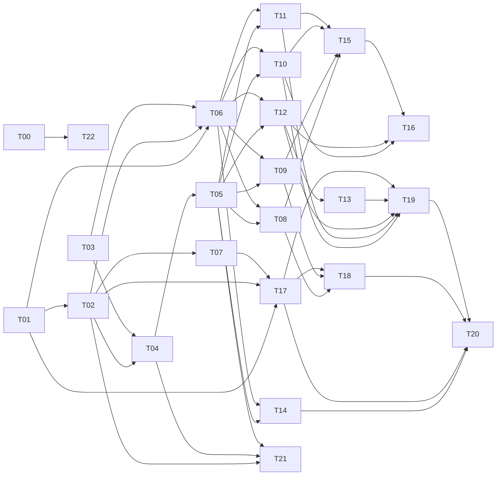

# Plan prac — Warehouse (podział na czaty)

Cel: zaimplementować model domenowy i warstwę persystencji w **23 małych zadaniach**, każde do wykonania w osobnym czacie (szacunek 5–14k tokenów wyjścia), z minimalnym kontekstem wejściowym.

## Jak pracować

1. Otwórz nowy czat. Załącz pliki wymienione w sekcji „Co załączyć" w pliku zadania `zadania/Txx_*.md` (zawsze: `01_KONWENCJE_PROJEKTU.md`, `02_SZABLON_RAPORTU.md`; do tego fragmenty `domena/*.md` i **raporty** zależności).
2. Wklej „Prompt startowy" z pliku zadania. Czat tworzy kod i na końcu `RAPORT_Txx.md`.
3. Kod commituj do repo; **raport** zachowaj — jest wejściem dla zależnych zadań (zamiast całego kodu, żeby oszczędzać tokeny).
4. Odhacz zadanie w tabeli statusu poniżej. Zadania z tej samej fali są niezależne i można je robić równolegle.

## Zasady stałe

- Kontrakt wspólny: `01_KONWENCJE_PROJEKTU.md` (rozstrzyga decyzje K-1…K-10; wygrywa nad `domena/*.md`).
- Odstępstwa i pytania do architekta trafiają do raportu, nie do cichej zmiany kontraktu. Po każdej fali przejrzyj sekcje „Odstępstwa" i w razie potrzeby zaktualizuj `01_KONWENCJE`.
- Czat nie poprawia cudzego kodu. Błąd w cudzym pliku → raport → osobna poprawka.
- Status `PARTIAL` → uruchom czat kontynuacyjny z raportem jako briefem.

## Fale i zadania

### Fala 0 — szkielet

| Zadanie | Tytuł | Zależy od | Szacunek | Status |
|---------|-------|-----------|----------|:------:|
| T00 | Szkielet rozwiązania | — | ~8k tokenów | ☐ |

### Fala 1 — fundamenty (równolegle)

| Zadanie | Tytuł | Zależy od | Szacunek | Status |
|---------|-------|-----------|----------|:------:|
| T01 | Strongly-typed ID + konwertery | — | ~6k tokenów | ☐ |
| T03 | Enumeracje (zwykłe i smart enums) | — | ~5k tokenów | ☐ |

### Fala 2

| Zadanie | Tytuł | Zależy od | Szacunek | Status |
|---------|-------|-----------|----------|:------:|
| T02 | SharedKernel — klasy bazowe i abstrakcje | T01 | ~9k tokenów | ☐ |

### Fala 3 (równolegle)

| Zadanie | Tytuł | Zależy od | Szacunek | Status |
|---------|-------|-----------|----------|:------:|
| T04 | Value objecty ogólne | T02, T03 | ~7k tokenów | ☐ |
| T07 | Abstrakcje aplikacyjne (Application/Abstractions) | T01, T02 | ~8k tokenów | ☐ |

### Fala 4 (równolegle)

| Zadanie | Tytuł | Zależy od | Szacunek | Status |
|---------|-------|-----------|----------|:------:|
| T05 | Value objecty domenowe | T02, T03, T04 | ~7k tokenów | ☐ |
| T06 | Zdarzenia domenowe (wszystkie) | T01, T02, T03 | ~6k tokenów | ☐ |
| T17 | Infrastruktura — DbContext, konwencje, interceptory | T01, T02, T07 | ~12k tokenów | ☐ |

### Fala 5 — agregaty domenowe (do 7 czatów równolegle)

| Zadanie | Tytuł | Zależy od | Szacunek | Status |
|---------|-------|-----------|----------|:------:|
| T08 | Tenancy + Catalog (agregaty) | T02, T04, T05, T06 | ~12k tokenów | ☐ |
| T09 | Locations (agregaty) | T02, T04, T05, T06 | ~8k tokenów | ☐ |
| T10 | Inventory A — StockMovement, StockLevel, Lot, SerialItem | T02, T03, T04, T05, T06 | ~12k tokenów | ☐ |
| T11 | Inventory B — Reservation, CostLayer, SkuCostBalance | T02, T03, T04, T05, T06 | ~8k tokenów | ☐ |
| T12 | Documents core + PZ + WZ | T02, T03, T04, T05, T06, T10 | ~12k tokenów | ☐ |
| T13 | Documents — MM, PW, RW, KOR | T12 | ~10k tokenów | ☐ |
| T14 | Fulfillment + Stocktaking + Alerts | T02, T03, T04, T05, T06 | ~10k tokenów | ☐ |

### Fala 6

| Zadanie | Tytuł | Zależy od | Szacunek | Status |
|---------|-------|-----------|----------|:------:|
| T15 | Serwisy domenowe — strategie i polityki | T08, T09, T10, T11 | ~14k tokenów | ☐ |
| T18 | EF — konfiguracje: Tenancy, Catalog, Locations | T08, T09, T17 | ~10k tokenów | ☐ |

### Fala 7

| Zadanie | Tytuł | Zależy od | Szacunek | Status |
|---------|-------|-----------|----------|:------:|
| T16 | IStockPostingService — księgowanie ruchów | T10, T12, T15 | ~12k tokenów | ☐ |
| T19 | EF — konfiguracje: Inventory + Documents | T10, T11, T12, T13, T17 | ~12k tokenów | ☐ |

### Fala 8

| Zadanie | Tytuł | Zależy od | Szacunek | Status |
|---------|-------|-----------|----------|:------:|
| T20 | EF — konfiguracje: Fulfillment, Stocktaking, Alerts, Platforma + migracja początkowa | T14, T17, T18, T19 | ~8k tokenów | ☐ |

### Fala 9 — testy (równolegle)

| Zadanie | Tytuł | Zależy od | Szacunek | Status |
|---------|-------|-----------|----------|:------:|
| T21 | Testy jednostkowe: SharedKernel i Value Objecty | T04, T05, T02 | ~9k tokenów | ☐ |
| T22 | Testy architektury | T00, T08 | ~5k tokenów | ☐ |

## Graf zależności (skrót)

## Mapa fragmentów domeny (co wkleić gdzie)

| Plik | Zawartość | Używany w |
|------|-----------|-----------|
| `domena/D00_konwencje.md` | konwencje ogólne (§0) | wszystkie (skrót; wiążące są `01_KONWENCJE`) |
| `domena/D01_hierarchia.md` | drzewo dziedziczenia + diagram | T02, T17 |
| `domena/D02_sharedkernel.md` | interfejsy, klasy abstrakcyjne, Result/Error | T02, T03, T06, T07, T17 |
| `domena/D03_identyfikatory.md` | lista strongly-typed ID | T01 |
| `domena/D04_value_objects.md` | value objecty | T04, T05, T21 |
| `domena/D05_enumeracje.md` | enumy i smart enums | T03, T05 |
| `domena/D06_0…D06_9` | klasy per kontekst (+ platforma) | T08–T14, T18–T20 |
| `domena/D07_serwisy_domenowe.md` | interfejsy serwisów/polityk | T15, T16 |
| `domena/D08_abstrakcje_aplikacyjne.md` | IClock, ICurrentUser, CQRS… | T07 |
| `domena/D09_zdarzenia.md` | tabela zdarzeń | T06 |
| `domena/D10_maszyny_stanow.md` | maszyny stanów | T03, T11, T12, T14 |
| `domena/D11_niezmienniki.md` | niezmienniki systemowe | T16, T22 |
| `domena/D12_persystencja.md` | wskazówki EF/Postgres | T17–T20 |
| `domena/D13_otwarte_decyzje.md` | otwarte decyzje (rozstrzygnięte w `01_KONWENCJE`) | tylko architekt |

## Co dalej (po T22)

Kolejna paczka zadań: **slice'y** (`Features/…`) — po jednym czacie na slice lub małą grupę (np. CRUD Catalog, CRUD Locations, ApproveReceipt, ApproveIssue, Transfer, Reservations, Picking, Stocktake), potem Terraform/APIM/CI-CD. Po zakończeniu fali 5 wygeneruję briefy dla slice'ów w tym samym formacie.

