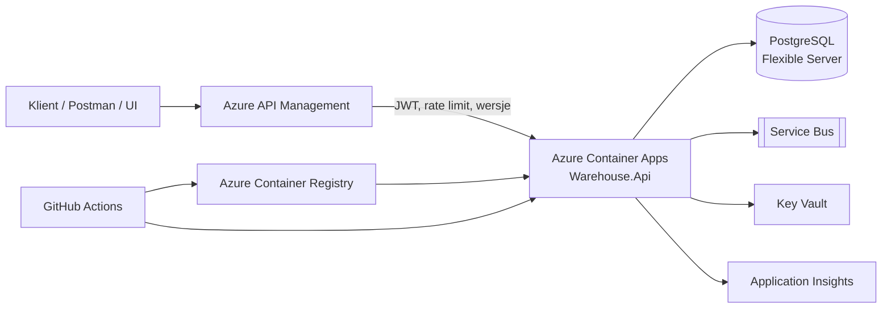

# Warehouse — założenia projektu

> Zaawansowany system magazynowy (WMS-lite) jako projekt portfolio.
> .NET 10 · Vertical Slice · DDD · PostgreSQL · Azure Container Apps · Azure API Management

Status: **draft v0.1** — dokument żywy, zmiany decyzji rejestrujemy jako ADR (`docs/adr/`).

---

## 1. Cel projektu

1. Zbudować realistyczny, produkcyjnie wyglądający system magazynowy obejmujący pełny cykl operacji magazynowych.
2. Pokazać w portfolio: DDD, vertical slice, współbieżność, spójność danych, event-driven (outbox), cloud-native (Azure), IaC, CI/CD, observability.
3. Mieć repozytorium, w którym **dokumentacja jest częścią kodu** (wszystko w markdown, wersjonowane z kodem).

### Poza zakresem (non-goals)
- Pełna księgowość / finanse (system zna wartość zapasów, nie prowadzi ksiąg).
- Integracje z fizycznym sprzętem (skanery, wózki) — tylko API gotowe pod takie integracje.
- Frontend w v1 (opcjonalnie później prosty UI; fokus na API).

---

## 2. Zakres funkcjonalny

### 2.1 Dane podstawowe (Master data)
- **Katalog towarów (SKU)** — jednostki miary, przeliczniki, warianty, EAN, atrybuty (waga, wymiary), flagi (partie, numery seryjne, data ważności).
- **Magazyny i lokalizacje** — magazyn → strefa → regał → półka/lokalizacja (hierarchia), typy lokalizacji (przyjęcia, składowanie, kompletacja, wydania, kwarantanna, braki).
- **Kontrahenci** — dostawcy, odbiorcy.

### 2.2 Operacje magazynowe
| Kod | Operacja | Opis |
|-----|----------|------|
| PZ  | Przyjęcie zewnętrzne | Przyjęcie towaru od dostawcy (na podstawie zamówienia zakupu lub bez) |
| WZ  | Wydanie zewnętrzne | Wydanie towaru odbiorcy |
| MM  | Przesunięcie międzymagazynowe / międzylokalizacyjne | Z lokalizacji do lokalizacji, ewentualnie z tranzytem |
| PW  | Przyjęcie wewnętrzne | Np. z produkcji / nadwyżka |
| RW  | Rozchód wewnętrzny | Np. zużycie, szkoda, na potrzeby własne |
| INW | Inwentaryzacja | Spis z natury, różnice → automatyczne PW/RW korygujące |
| KOR | Korekty | Korekta dokumentów (bez edycji historii — korekta jako nowy dokument) |
| REZ | Rezerwacje | Rezerwacja stanu pod zamówienie (miękka/twarda), wygasanie rezerwacji |
| PICK | Kompletacja | Zlecenia kompletacji, listy pickingowe, strategia FIFO / FEFO |
| PUT | Rozlokowanie | Putaway — propozycje lokalizacji dla przyjętego towaru |

### 2.3 Funkcje zaawansowane
- **Partie i numery seryjne** z pełną śledzalnością (traceability: skąd → dokąd).
- **Strategie rozchodu**: FIFO, FEFO (data ważności), LIFO (opcjonalnie), wskazana partia.
- **Wycena zapasów**: średnia ważona / FIFO (wartość ruchu zapisywana w ledgerze).
- **Alerty i reguły**: minimalne stany, zbliżająca się data ważności, rozjazdy inwentaryzacyjne.
- **Raporty**: stan na dzień, obroty, rotacja, ABC, historia ruchów towaru.
- **Audyt**: kto, co, kiedy, z jakiego dokumentu — nic nie jest kasowane.

---

## 3. Kluczowe założenia domenowe (DDD)

### 3.1 Główna zasada: dziennik ruchów (Stock Ledger)
- **Źródłem prawdy jest niezmienny dziennik ruchów magazynowych** (`StockMovement`) — tylko dopisywanie.
- **Stan magazynowy (`StockLevel`) to projekcja** dziennika, aktualizowana transakcyjnie w tej samej transakcji co ruch.
- Dokumenty magazynowe (PZ/WZ/MM…) są agregatami, które po zatwierdzeniu **generują ruchy**.
- Korekta = nowy dokument/ruch odwracający, nigdy edycja historii.

### 3.2 Bounded contexts (moduły logiczne w jednym projekcie)
| Kontekst | Odpowiedzialność |
|----------|------------------|
| **Catalog** | SKU, jednostki, warianty, kontrahenci |
| **Locations** | Magazyny, lokalizacje, typy |
| **Inventory** | Ledger, stany, rezerwacje, partie, seriale (rdzeń domeny) |
| **Documents** | Dokumenty PZ/WZ/MM/PW/RW/KOR i ich cykl życia |
| **Fulfillment** | Zlecenia kompletacji, picking, putaway |
| **Stocktaking** | Inwentaryzacje i różnice |
| **Reporting** | Read modele, raporty (CQRS po stronie odczytu) |
| **Identity/Audit** | Użytkownicy z tokenu, audyt, uprawnienia |

> Granice kontekstów egzekwujemy konwencją folderów + testami architektury (patrz §5.4), nie osobnymi projektami.

### 3.3 Przykładowe agregaty i value objecty
- **Agregaty**: `Sku`, `Warehouse`, `Location`, `WarehouseDocument`, `Reservation`, `StockTake`, `PickingOrder`.
- **Value objects**: `Quantity` (wartość + jednostka), `Money`, `Sku Code`, `LotNumber`, `SerialNumber`, `LocationCode`, `DocumentNumber`.
- **Zdarzenia domenowe**: `DocumentApproved`, `StockMoved`, `StockReserved`, `ReservationExpired`, `StockTakeClosed`, `LowStockDetected`.
- **Niezmienniki** (przykłady): stan nie może spaść poniżej zera (chyba że magazyn zezwala), dokument zatwierdzony jest niemutowalny, ruch zawsze należy do dokumentu, rezerwacja nie przekroczy stanu dostępnego.

### 3.4 Ubiquitous language
Słownik pojęć domenowych utrzymujemy w `docs/domain/glossary.md` — nazwy w kodzie = nazwy w słowniku (angielskie nazwy w kodzie, polskie odpowiedniki w słowniku).

---

## 4. Architektura

### 4.1 Zmiana podejścia
| Było | Jest |
|------|------|
| Clean Architecture, wiele projektów (Domain / Application / Infrastructure / Api) | **Jeden projekt Web API** |
| Warstwy techniczne (Services, Repositories) | **Vertical Slice** — organizacja po funkcjach (use case'ach) |
| Anemiczny model + EF Core | **Bogaty model domenowy (DDD)**; persystencja jako szczegół implementacyjny |

**Uzasadnienie**: mniej ceremonii, mniejszy koszt zmiany, kod jednej funkcji leży obok siebie; DDD zostaje tam, gdzie daje wartość (logika w agregatach), a nie jako zestaw warstw.

### 4.2 Zasady
1. **Slice = jeden use case** (komenda lub zapytanie): endpoint + request/response + handler + walidator (+ ewentualnie mapowanie) w jednym folderze.
2. **Logika biznesowa w domenie** (agregaty, value objects, domain services) — handlery tylko orkiestrują: wczytaj agregat → wywołaj metodę domenową → zapisz.
3. **Slice'y nie wołają innych slice'ów.** Współdzielone rzeczy → domena lub `Shared/`. Komunikacja między kontekstami → zdarzenia domenowe / integracyjne.
4. **CQRS pragmatyczny**: komendy przechodzą przez agregaty; zapytania mogą czytać bezpośrednio z DB (EF `AsNoTracking` lub zapytania SQL/Dapper) bez ładowania agregatów.
5. **Spójność transakcyjna w obrębie agregatu**; między agregatami — eventual consistency (zdarzenia), z wyjątkiem ledgera (patrz §3.1).
6. **Bez generycznych repozytoriów.** Handler używa `DbContext` / wąskich interfejsów tam, gdzie to ma sens.

### 4.3 Proponowana struktura repozytorium
```text
warehouse/
├── docs/                       # cała dokumentacja w markdown
│   ├── 00-overview.md
│   ├── adr/                    # Architecture Decision Records
│   ├── domain/                 # glossary, agregaty, zdarzenia, reguły
│   ├── api/                    # konwencje API, wersjonowanie, błędy
│   ├── architecture/           # C4 (mermaid), deployment, security
│   └── runbooks/               # operacje, troubleshooting
├── src/
│   └── Warehouse.Api/
│       ├── Program.cs
│       ├── Domain/             # model domenowy per kontekst
│       │   ├── Inventory/
│       │   ├── Documents/
│       │   └── ...
│       ├── Features/           # vertical slices
│       │   ├── Documents/
│       │   │   ├── ApproveReceipt/
│       │   │   │   ├── Endpoint.cs
│       │   │   │   ├── Command.cs
│       │   │   │   ├── Handler.cs
│       │   │   │   └── Validator.cs
│       │   │   └── ...
│       │   ├── Inventory/
│       │   └── ...
│       ├── Infrastructure/     # DbContext, konfiguracje, outbox, auth, telemetria
│       └── Shared/             # wyniki, błędy, abstrakcje cross-cutting
├── tests/
│   ├── Warehouse.UnitTests/            # domena (czyste testy agregatów)
│   ├── Warehouse.IntegrationTests/     # API + Postgres (Testcontainers)
│   └── Warehouse.ArchitectureTests/    # reguły architektury
├── infra/                      # Terraform
├── .github/workflows/          # CI/CD
├── docker-compose.yml          # lokalne środowisko (Postgres, Azurite, emulatory)
└── README.md
```
> Testy są osobnymi projektami — to nie narusza zasady „jeden projekt Web API".

### 4.4 Stack technologiczny
| Obszar | Wybór | Uwagi |
|--------|-------|-------|
| Runtime | **.NET 10**, C# 14 | Minimal APIs |
| Baza danych | **PostgreSQL** (Azure Database for PostgreSQL – Flexible Server) | JSONB tam, gdzie sensowne; `xmin` / rowversion do optymistycznej współbieżności |
| Dostęp do danych | **EF Core + Npgsql** (komendy) + opcjonalnie Dapper/SQL (zapytania raportowe) | **Do decyzji → ADR-003** (zostać przy EF Core czy nie) |
| Walidacja | FluentValidation | Per slice |
| Dispatch handlerów | Własny lekki dispatcher lub biblioteka (Wolverine / Mediator source-gen) | **Do decyzji → ADR-004** (MediatR jest już komercyjny) |
| Komunikaty | Azure Service Bus + **Outbox pattern** | Zdarzenia integracyjne |
| Auth | Microsoft Entra ID (JWT), role/claims | Walidacja na APIM i w API |
| Obserwowalność | OpenTelemetry → Azure Monitor / Application Insights | Logi strukturalne (Serilog), trace correlation |
| Dokumentacja API | OpenAPI (wbudowane w .NET 10) + Scalar | Eksportowane do APIM |
| Testy | xUnit, Testcontainers, NetArchTest/ArchUnitNET | |
| IaC | Terraform | Moduły: container apps, apim, postgres, keyvault, servicebus, monitoring |
| CI/CD | GitHub Actions | Build → test → image → deploy |

---

## 5. Architektura chmurowa (Azure)



### 5.1 Azure API Management
- Jedyny publiczny punkt wejścia do API.
- Polityki: walidacja JWT, rate limiting / throttling, CORS, wersjonowanie (`/v1`), correlation-id, cache dla zapytań referencyjnych, maskowanie nagłówków.
- Definicja API importowana z OpenAPI generowanego w CI.
- Container App dostępny tylko z APIM (ingress ograniczony / VNet).

### 5.2 Azure Container Apps
- Obraz Docker (multi-stage, chiseled/distroless gdzie się da), rejestr: ACR.
- Skalowanie: HTTP + (opcjonalnie) KEDA po kolejce Service Bus.
- **Managed Identity** do Key Vault, Service Bus, ACR — bez haseł w konfiguracji.
- Rewizje + traffic splitting (blue/green / canary).
- Osobny **job** (Container Apps Job) na zadania cykliczne: wygasanie rezerwacji, alerty dat ważności, przeliczenia.

### 5.3 PostgreSQL
- Azure Database for PostgreSQL – Flexible Server, dostęp prywatny, backupy PITR.
- Migracje: EF Core migrations (lub DbUp/Flyway — **ADR**), uruchamiane jako krok pipeline'u, nie przy starcie aplikacji.
- Schematy per kontekst (`inventory`, `documents`, `catalog`…) — porządkują model bez rozbijania na osobne bazy.
- Blokady i współbieżność: `SELECT ... FOR UPDATE` / optymistyczne `xmin` dla stanów; unikalne indeksy jako ostatnia linia obrony niezmienników.

### 5.4 Egzekwowanie architektury
Testy architektury muszą pilnować, że:
- `Domain` nie zależy od `Infrastructure`, EF Core ani ASP.NET,
- `Features/X` nie referuje `Features/Y`,
- kontekst `A` nie sięga do wnętrzności kontekstu `B` (tylko publiczne kontrakty/zdarzenia).

---

## 6. Wymagania niefunkcjonalne

| Obszar | Założenie |
|--------|-----------|
| **Spójność** | Brak ujemnych/rozjechanych stanów; ruch + stan w jednej transakcji |
| **Idempotentność** | Komendy mutujące przyjmują `Idempotency-Key`; ponowienie nie dubluje ruchu |
| **Współbieżność** | Równoległe WZ na ten sam towar nie mogą przekroczyć stanu (test obciążeniowy w CI) |
| **Wydajność** | p95 odczytu < 150 ms, zapisu < 300 ms przy typowym obciążeniu (cel, nie gwarancja) |
| **Bezpieczeństwo** | JWT, least privilege, sekrety w Key Vault, brak sekretów w repo, skan zależności (Dependabot) |
| **Audyt** | Każda zmiana stanu śledzona do użytkownika i dokumentu |
| **Obserwowalność** | Trace end-to-end (APIM → API → DB), metryki biznesowe (liczba ruchów, rezerwacji, błędów) |
| **Testowalność** | Domena testowana bez infrastruktury; integracja na prawdziwym Postgresie |
| **Błędy** | `ProblemDetails` (RFC 9457), spójne kody błędów domenowych |

---

## 7. Konwencje API

- REST, zasoby w liczbie mnogiej: `/v1/documents/receipts`, `/v1/stock-levels`, `/v1/locations`.
- Akcje domenowe jako sub-zasoby/komendy: `POST /v1/documents/receipts/{id}/approve`.
- Paginacja kursorowa dla list, filtrowanie i sortowanie jawnie opisane w OpenAPI.
- Nagłówki: `Idempotency-Key`, `X-Correlation-Id`, `ETag` / `If-Match` dla współbieżności.
- Wersjonowanie w ścieżce (`/v1`), polityka deprecjacji opisana w `docs/api/`.

---

## 8. Dokumentacja w markdown — zasady

- **Wszystko w repo, w `docs/`**, wersjonowane razem z kodem.
- **ADR** w formacie: Kontekst → Decyzja → Konsekwencje → Alternatywy; numerowane `ADR-001-...md`.
- Diagramy jako **Mermaid** (C4, sekwencje, maszyny stanów dokumentów).
- Każdy kontekst ma plik `docs/domain/<kontekst>.md`: agregaty, niezmienniki, zdarzenia, przykłady.
- Każda większa funkcja zaczyna się od krótkiego specu (`docs/features/<nazwa>.md`) — dopiero potem kod.
- Definition of Done: kod + testy + aktualizacja dokumentacji.

---

## 9. Plan realizacji (roadmapa)

| Faza | Zakres | Rezultat |
|------|--------|----------|
| **0. Fundament** | Repo, struktura, `docs/`, ADR-001..004, CI (build+test), docker-compose, szkielet API | Zielony pipeline, hello-world w Container Apps |
| **1. Catalog + Locations** | SKU, jednostki, magazyny, lokalizacje | CRUD z walidacją i testami |
| **2. Inventory core** | Ledger, stany, `Quantity`, PZ / WZ, optymistyczna współbieżność | Podstawowy obieg towaru, testy współbieżności |
| **3. Dokumenty** | MM, PW, RW, KOR, cykl życia dokumentu (szkic → zatwierdzony → anulowany/skorygowany) | Pełny zestaw dokumentów |
| **4. Partie i seriale** | Lot/serial, FIFO/FEFO, traceability | Śledzenie pochodzenia towaru |
| **5. Rezerwacje i kompletacja** | Rezerwacje, wygasanie, picking, putaway | Realizacja zamówień |
| **6. Inwentaryzacja** | Spis, różnice, dokumenty korygujące | Zamknięty cykl kontroli stanów |
| **7. Azure produkcyjnie** | Terraform, APIM, Entra ID, Service Bus + outbox, Key Vault, OTel | Środowisko dev/prod |
| **8. Raportowanie** | Read modele, ABC, rotacja, historia towaru | Raporty + metryki |
| **9. Polish** | Load testy, README, diagramy, demo, scenariusze w Postmanie/`.http` | Portfolio-ready |

---

## 10. Otwarte decyzje (do rozstrzygnięcia jako ADR)

1. **ADR-001** — Vertical Slice w jednym projekcie + zasady granic (ten dokument jako punkt wyjścia).
2. **ADR-002** — Ledger jako źródło prawdy + stan jako projekcja (vs. czysty event sourcing).
3. **ADR-003** — EF Core vs. alternatywy (Dapper / Marten na Postgresie) dla warstwy zapisu.
4. **ADR-004** — Dispatch handlerów: własny / Wolverine / Mediator (source-gen).
5. **ADR-005** — Narzędzie migracji (EF Migrations vs. DbUp/Flyway).
6. **ADR-006** — Model uprawnień (role vs. policy-based, per magazyn).
7. **ADR-007** — Multi-tenancy (jeden tenant w v1 vs. od początku `TenantId`).
8. **ADR-008** — Strategia wyceny zapasów (średnia ważona vs. FIFO).

---

## 11. Kryteria sukcesu (portfolio)

- [ ] `docker compose up` uruchamia całość lokalnie jednym poleceniem.
- [ ] Pipeline: build → testy → obraz → deploy do Container Apps.
- [ ] Publiczne API wystawione przez APIM z dokumentacją OpenAPI.
- [ ] Testy współbieżności dowodzą, że stan nie schodzi poniżej zera.
- [ ] Testy architektury pilnują granic slice'ów i kontekstów.
- [ ] Dokumentacja (`docs/`) pozwala nowej osobie zrozumieć system w < 30 minut.
- [ ] Trace jednego żądania widoczny end-to-end w Application Insights.
