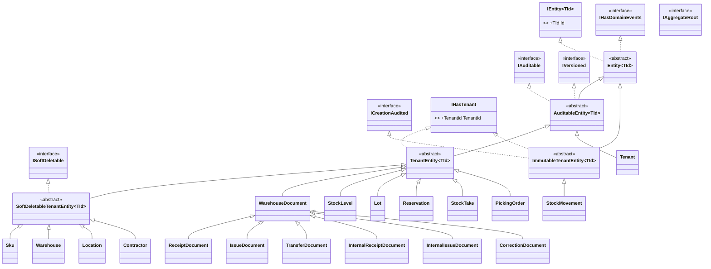

<!-- Fragment DOMENA.md (D01_hierarchia). Pełny kontekst: ref/DOMENA.md -->

## 1. Hierarchia dziedziczenia — przegląd

### 1.1 Drzewo klas bazowych (SharedKernel)

```text
Entity<TId>                                  : IEntity<TId>, IHasDomainEvents
│
├── AuditableEntity<TId>                     : IAuditable, IVersioned
│   │
│   ├── Tenant                               : IAggregateRoot   (jedyna encja BEZ TenantId — korzeń tenantów)
│   │
│   └── TenantEntity<TId>   (abstract)       : IHasTenant
│       │
│       ├── SoftDeletableTenantEntity<TId>   : ISoftDeletable   (dane podstawowe)
│       │   ├── Sku                          : IAggregateRoot
│       │   ├── SkuCategory                  : IAggregateRoot
│       │   ├── Contractor                   : IAggregateRoot
│       │   ├── Warehouse                    : IAggregateRoot
│       │   ├── Location                     : IAggregateRoot
│       │   └── UnitOfMeasure
│       │
│       ├── WarehouseDocument   (abstract)   : IAggregateRoot
│       │   ├── ReceiptDocument              (PZ)
│       │   ├── IssueDocument                (WZ)
│       │   ├── TransferDocument             (MM)
│       │   ├── InternalReceiptDocument      (PW)
│       │   ├── InternalIssueDocument        (RW)
│       │   └── CorrectionDocument           (KOR)
│       │
│       ├── DocumentLine        (abstract)   (encja zależna od dokumentu)
│       │   ├── ReceiptLine
│       │   ├── IssueLine
│       │   ├── TransferLine
│       │   ├── InternalReceiptLine
│       │   ├── InternalIssueLine
│       │   └── CorrectionLine
│       │
│       ├── StockLevel                       : IAggregateRoot
│       ├── Lot                              : IAggregateRoot
│       ├── SerialItem                       : IAggregateRoot
│       ├── Reservation                      : IAggregateRoot
│       │   ├── ReservationLine              (zależna)
│       │   └── ReservationAllocation        (zależna)
│       ├── CostLayer
│       ├── SkuCostBalance
│       ├── PickingOrder                     : IAggregateRoot
│       │   └── PickingLine                  (zależna)
│       ├── PutawayTask                      : IAggregateRoot
│       ├── StockTake                        : IAggregateRoot
│       │   └── StockTakeLine                (zależna)
│       ├── AlertRule                        : IAggregateRoot
│       ├── Alert
│       ├── DocumentNumberSequence
│       └── (encje zależne katalogu: SkuBarcode, SkuUnitConversion, ContractorAddress, ContractorContact)
│
└── ImmutableTenantEntity<TId> (abstract)    : IHasTenant, ICreationAudited   (append-only)
    └── StockMovement                        (dziennik ruchów — źródło prawdy)

ValueObject (abstract)                       : IEquatable<ValueObject>
Enumeration (abstract)                       : IComparable   (smart enums)
```

### 1.2 Diagram (Mermaid)



### 1.3 Zasada doboru klasy bazowej

| Potrzeba | Klasa bazowa |
|----------|--------------|
| Dane podstawowe, które się dezaktywuje/„usuwa" logicznie | `SoftDeletableTenantEntity<TId>` |
| Dokumenty, rezerwacje, stany, zlecenia (mutowalne, audytowane, bez soft-delete — mają własny status) | `TenantEntity<TId>` |
| Wpisy append-only (ledger) | `ImmutableTenantEntity<TId>` |
| Korzeń tenantów | `AuditableEntity<TId>` |

> **Encje zależne** (linie dokumentu itp.) też dziedziczą po `TenantEntity<TId>` — `TenantId` jest zdenormalizowany, bo query filter i indeksy muszą działać bez joina do nagłówka. Ustawiany z agregatu-rodzica w fabryce.
